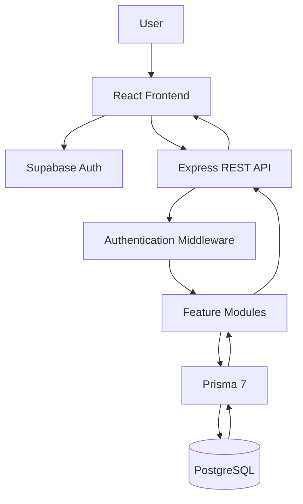

# Nexora

**A Full-Stack Project Management and Team Collaboration Platform**

Nexora is a full-stack collaboration platform built to help software teams organize projects, manage tasks, coordinate teammates, and track development progress.

It provides workspace-based collaboration with role-based access control, task management, comments, activity history, and database-backed notifications.

## Features

### Authentication and Workspaces
- Supabase authentication with email sign-up and sign-in.
- Secure session management and password recovery.
- Workspace creation and membership.
- Role-based access control with OWNER, ADMIN, and MEMBER roles.
- Workspace invitations with email delivery and acceptance.
- Invitation listing, resend, and revocation.

### Project and Task Management
- Create and manage projects inside workspaces.
- Create, edit, and delete tasks.
- Task statuses: TODO, IN_PROGRESS, and DONE.
- Task priorities: LOW, MEDIUM, and HIGH.
- Optional task due dates.
- Drag-and-drop task status updates.
- Assign tasks to workspace members.
- Reusable workspace labels with custom colors.

### Multiple Project Views
- **Board View:** Organize tasks by status.
- **List View:** View and manage tasks in a structured list.
- **Calendar View:** Visualize tasks by due date.
- **Overview View:** Access project overview information.

### Collaboration
- Task comments with author-based editing and deletion permissions.
- Task activity history.
- In-app notifications for:
  - New task assignments.
  - New comments.
  - Task updates.
- Notification unread count.
- Individual and bulk notification read management.
- Task navigation from notification items when the task is available in the selected project.

### Engineering
- Feature-oriented backend architecture.
- Protected REST API endpoints.
- Workspace-scoped authorization.
- Prisma database migrations.
- Automated backend tests using Vitest and Supertest.

## Technology Stack

| Layer | Technologies |
|---|---|
| Frontend | React, TypeScript, Vite |
| Styling | Tailwind CSS |
| Backend | Node.js, Express.js, TypeScript |
| Database | PostgreSQL, Supabase |
| Authentication | Supabase Auth |
| ORM | Prisma 7 |
| Database Adapter | Prisma PostgreSQL Adapter |
| Validation | Zod |
| Caching / Performance | Redis |
| Testing | Vitest, Supertest |
| Version Control | Git, GitHub |

## Architecture

Nexora uses a separated frontend and backend architecture.



### Request Flow

```text
User Interaction
      ↓
React Component
      ↓
Custom Hook
      ↓
Frontend Service
      ↓
Express REST API
      ↓
Authentication Middleware
      ↓
Feature Service
      ↓
Prisma ORM
      ↓
PostgreSQL
```

For more details, see [`docs/architecture.md`](docs/architecture.md).

## Project Structure

```text
Nexora/
│
├── frontend/
│   └── src/
│       ├── app/
│       ├── components/
│       │   ├── modals/
│       │   ├── tasks/
│       │   └── notifications/
│       ├── features/
│       │   ├── auth/
│       │   └── invites/
│       ├── hooks/
│       ├── lib/
│       └── services/
│
├── backend/
│   ├── prisma/
│   │   ├── schema.prisma
│   │   └── migrations/
│   └── src/
│       ├── config/
│       ├── middleware/
│       ├── modules/
│       │   ├── auth/
│       │   ├── labels/
│       │   ├── projects/
│       │   ├── tasks/
│       │   ├── workspaces/
│       │   └── notifications/
│       ├── routes/
│       ├── test/
│       └── generated/
│
├── docs/
│   └── architecture.md
│
├── NEXORA_PLAN.md
└── README.md
```

## Getting Started

### Prerequisites

Install the following:

- Node.js
- npm
- Git
- A Supabase project with Email authentication enabled
- PostgreSQL access through your Supabase project

### 1. Clone the repository

```bash
git clone https://github.com/Amrittt22/Nexora.git
cd Nexora
```

### 2. Configure Supabase

1. Create a Supabase project.
2. Enable Email authentication.
3. Configure the frontend redirect URLs.
4. Add `http://localhost:5173/**` to the allowed redirect URLs.
5. Obtain the project URL and publishable key.
6. Obtain the PostgreSQL Session Pooler connection string.

Password recovery uses:

```text
http://localhost:5173/reset-password
```

Invitation acceptance uses:

```text
http://localhost:5173/invite
```

Both routes must be permitted in Supabase Redirect URLs.

### 3. Configure backend environment variables

Create `backend/.env`:

```env
DATABASE_URL="your-supabase-postgresql-connection-string"

SUPABASE_URL="https://your-project-ref.supabase.co"
SUPABASE_PUBLISHABLE_KEY="your-publishable-key"
SUPABASE_SECRET_KEY="your-server-only-secret-key"

FRONTEND_URL="http://localhost:5173"
PORT=4000
```

### 4. Configure frontend environment variables

Create `frontend/.env`:

```env
VITE_SUPABASE_URL="https://your-project-ref.supabase.co"
VITE_SUPABASE_PUBLISHABLE_KEY="your-publishable-key"
VITE_API_URL="http://localhost:4000"
```

**Security:** Never commit `.env` files, database URLs, or server-side Supabase secrets to GitHub.

### 5. Install backend dependencies

```bash
cd backend
npm install
```

Generate the Prisma client:

```bash
npm run prisma7:generate
```

Apply database migrations:

```bash
npx prisma7 migrate deploy --config prisma7.config.ts
```

Start the backend:

```bash
npm run dev
```

The backend runs at:

```text
http://localhost:4000
```

Use the project's `prisma7` executable and configuration for Prisma operations.

### 6. Install frontend dependencies

Open a second terminal:

```bash
cd frontend
npm install
npm run dev
```

The frontend normally runs at:

```text
http://localhost:5173
```

## API Endpoints

All protected endpoints require a valid Supabase Bearer access token.

### Authentication

| Method | Endpoint | Description |
|---|---|---|
| GET | `/api/v1/auth/me` | Get authenticated user |

### Workspaces and Projects

| Method | Endpoint | Description |
|---|---|---|
| GET | `/api/v1/workspaces` | List user's workspaces |
| POST | `/api/v1/workspaces` | Create workspace |
| GET | `/api/v1/workspaces/:workspaceId/projects` | List workspace projects |
| POST | `/api/v1/workspaces/:workspaceId/projects` | Create project |
| GET | `/api/v1/workspaces/:workspaceId/members` | List workspace members |

### Invitations

| Method | Endpoint | Description |
|---|---|---|
| POST | `/api/v1/workspaces/:workspaceId/invites` | Create invitation |
| GET | `/api/v1/workspaces/:workspaceId/invites` | List invitations |
| POST | `/api/v1/workspaces/invites/:inviteId/accept` | Accept invitation |
| DELETE | `/api/v1/workspaces/:workspaceId/invites/:inviteId` | Revoke invitation |

### Tasks and Labels

| Method | Endpoint | Description |
|---|---|---|
| GET | `/api/v1/projects/:projectId/tasks` | List project tasks |
| POST | `/api/v1/projects/:projectId/tasks` | Create task |
| PATCH | `/api/v1/tasks/:taskId` | Update task |
| DELETE | `/api/v1/tasks/:taskId` | Delete task |
| PUT | `/api/v1/tasks/:taskId/labels` | Replace task labels |
| PUT | `/api/v1/tasks/:taskId/assignees` | Replace task assignees |
| GET | `/api/v1/workspaces/:workspaceId/labels` | List workspace labels |
| POST | `/api/v1/workspaces/:workspaceId/labels` | Create label |

### Task Collaboration

| Method | Endpoint | Description |
|---|---|---|
| GET | `/api/v1/tasks/:taskId/activity` | Get task activity |
| GET | `/api/v1/tasks/:taskId/comments` | List task comments |
| POST | `/api/v1/tasks/:taskId/comments` | Create comment |
| PATCH | `/api/v1/comments/:commentId` | Update comment |
| DELETE | `/api/v1/comments/:commentId` | Delete comment |

### Notifications

| Method | Endpoint | Description |
|---|---|---|
| GET | `/api/v1/notifications` | List notifications |
| GET | `/api/v1/notifications/unread-count` | Get unread count |
| PATCH | `/api/v1/notifications/read-all` | Mark all as read |
| PATCH | `/api/v1/notifications/:id/read` | Mark one as read |

## Testing

The backend uses Vitest and Supertest for unit and integration testing.

Run backend tests:

```bash
cd backend
npm test
```

Run the backend production build:

```bash
npm run build
```

Run the frontend production build:

```bash
cd frontend
npm run build
```

### Test Database Safety

Integration tests use a dedicated local PostgreSQL database named `devflow_test`.

The test database configuration checks that the connection targets the expected local database.

Never use the production Supabase database for destructive integration test operations.

## Roadmap

The core project management and collaboration foundation is implemented.

Upcoming development priorities include:

- Dedicated workspace member management.
- Role changes and member removal.
- Real-time collaboration.
- Improved accessibility and responsive design.
- Day Mode contrast improvements.
- Timeline and sprint planning.
- Issue tracking.
- Redis-based performance improvements.
- Docker and CI/CD.
- GitHub integration.
- AI-powered project assistance.

See [`NEXORA_PLAN.md`](NEXORA_PLAN.md) for the detailed development roadmap.

## Engineering Principles

- Backend authorization is mandatory for workspace-scoped operations.
- Database changes are managed through Prisma migrations.
- Business logic is organized into feature-based modules.
- Related database operations use transactions where required.
- Environment secrets are never committed.
- Important functionality is covered by automated tests.
