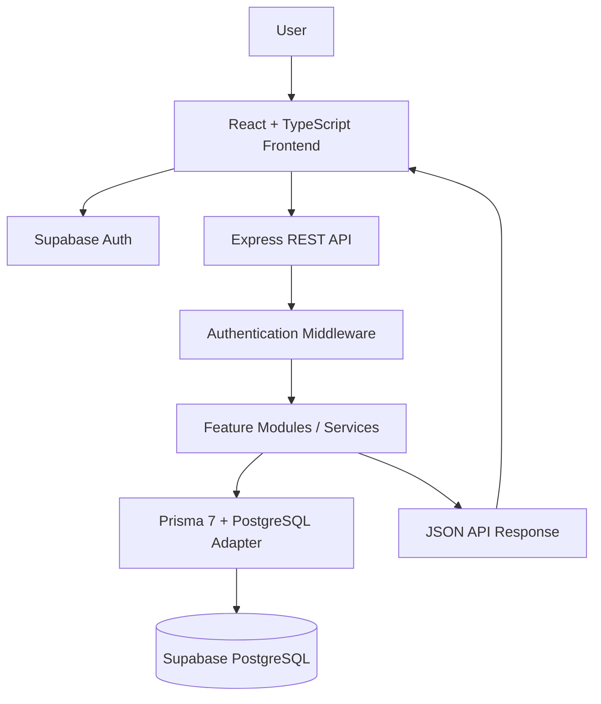
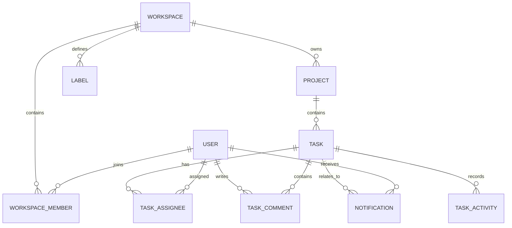
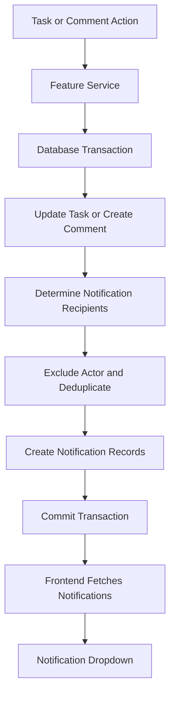

# Nexora — System Architecture

## 1. Overview

Nexora follows a feature-oriented full-stack architecture.

The application is divided into two main parts:

- **Frontend:** React application responsible for the user interface, authentication state, data fetching, and user interactions.
- **Backend:** Express REST API responsible for authentication verification, authorization, business logic, validation, and database operations.

The backend communicates with PostgreSQL through Prisma 7 and its PostgreSQL driver adapter. Supabase provides authentication and hosts the PostgreSQL database.

## 2. High-Level Architecture



## 3. Technology Stack

| Layer | Technology |
|---|---|
| Frontend framework | React |
| Frontend language | TypeScript |
| Build tool | Vite |
| Styling | Tailwind CSS |
| Backend runtime | Node.js |
| Backend framework | Express.js |
| Backend language | TypeScript |
| Authentication | Supabase Auth |
| Database | PostgreSQL via Supabase |
| ORM | Prisma 7 |
| Database adapter | `@prisma/adapter-pg` |
| Validation | Zod |
| Caching / performance | Redis |
| Testing | Vitest and Supertest |

## 4. Frontend Architecture

Frontend source code is organized by application responsibility and reusable feature logic.

### Main directories

```text
frontend/src/
├── app/
│   ├── App.tsx
│   └── types.ts
├── components/
│   ├── modals/
│   ├── tasks/
│   └── notifications/
├── features/
│   ├── auth/
│   └── invites/
├── hooks/
├── lib/
├── services/
└── ...
```

### Responsibilities

- `app/` — application shell, shared application types, and main interface composition.
- `components/` — reusable UI components, task views, modals, and notification interface.
- `features/` — feature-specific functionality such as authentication and invitation acceptance.
- `hooks/` — React hooks for managing application data and UI state.
- `lib/` — shared clients and application integrations, including Supabase.
- `services/` — API request functions and frontend-to-backend communication.

### Data flow

```text
React Component
      ↓
Custom Hook
      ↓
Frontend Service
      ↓
Express REST API
      ↓
JSON Response
      ↓
Hook State Update
      ↓
Component Re-render
```

The frontend uses the authenticated Supabase session to obtain an access token. Protected API requests send this token in the Authorization header as a Bearer token.

## 5. Backend Architecture

The backend uses a modular structure. Business logic is grouped by feature rather than placed into one large service layer.

### Main directory structure

```text
backend/
├── prisma/
│   ├── schema.prisma
│   └── migrations/
├── src/
│   ├── config/
│   ├── middleware/
│   ├── modules/
│   │   ├── auth/
│   │   ├── labels/
│   │   ├── projects/
│   │   ├── tasks/
│   │   ├── workspaces/
│   │   └── notifications/
│   ├── routes/
│   ├── test/
│   ├── generated/
│   │   └── prisma/
│   ├── app.ts
│   └── ...
├── prisma7.config.ts
└── prisma7.test.config.ts
```

### Responsibilities

- `config/` — Prisma client, Supabase clients, and test database configuration.
- `middleware/` — authentication and request-level protection.
- `modules/` — feature-specific business logic and service functions.
- `routes/` — REST API endpoint definitions and request handling.
- `test/` — backend unit and integration tests.
- `prisma/` — database schema and migration history.
- `generated/prisma/` — generated Prisma client.

### Request processing flow

```text
Incoming HTTP Request
        ↓
Express Router
        ↓
Authentication Middleware
        ↓
Route Handler
        ↓
Feature Service
        ↓
Prisma Client
        ↓
PostgreSQL
        ↓
JSON Response
```

Protected routes use `requireAuth` middleware. The middleware validates the Supabase access token and attaches the authenticated user to `res.locals.authUser`.

Feature services use the authenticated user's ID when performing user-scoped and workspace-scoped operations.

## 6. Authentication and Authorization

### Authentication

Supabase Auth manages:

- User registration.
- User sign-in.
- Session management.
- Sign-out.
- Password recovery.
- Invitation authentication flow.

The frontend obtains the current access token from the Supabase session.

The backend validates the token using Supabase's `auth.getUser()` operation.

### Authorization

Authentication establishes the user's identity. Authorization determines which operations the user is allowed to perform.

Nexora uses workspace roles:

| Role | Description |
|---|---|
| OWNER | Workspace ownership and privileged management operations |
| ADMIN | Administrative workspace operations permitted by the authorization rules |
| MEMBER | Standard workspace collaboration |

Every protected workspace-scoped operation must verify workspace membership and the required permission on the backend.

Task assignment validation ensures assigned users belong to the task's workspace.

Invitation authorization restricts role assignment and invitation management according to the actor's workspace role.

## 7. Database Architecture

PostgreSQL is the primary persistent data store.

Prisma 7 provides database access through the PostgreSQL driver adapter.

### Main domain entities

- **User:** application user associated with Supabase authentication.
- **Workspace:** collaboration boundary for members, projects, and shared resources.
- **WorkspaceMember:** membership and role information.
- **WorkspaceInvite:** invitation details, status, sender, role, and expiry.
- **Project:** project belonging to a workspace.
- **Task:** unit of work belonging to a project.
- **TaskAssignee:** relationship between tasks and assigned users.
- **Label:** reusable workspace label.
- **TaskActivity:** records important task events.
- **TaskComment:** comments associated with tasks.
- **Notification:** persistent notifications delivered to users.

### Important relationships



This diagram presents the main domain relationships; it is not an exhaustive rendering of every Prisma relation.

### Database migrations

Database schema changes are maintained through Prisma migrations.

- `backend/prisma/schema.prisma` defines the data model.
- `backend/prisma/migrations/` stores migration history.
- Prisma Client is generated from the schema.
- Production schema changes are applied through migration deployment.

Prisma 7 configuration is maintained separately in the backend configuration files. The application uses `DATABASE_URL` for its normal database connection.

## 8. Task Activity History

Task activity history provides a record of important task operations.

Supported activity categories include:

- `TASK_CREATED`
- `TASK_UPDATED`
- `STATUS_CHANGED`
- `LABELS_CHANGED`
- `ASSIGNEES_CHANGED`
- `TASK_DELETED`

Activity records are associated with tasks and include the event information needed to display a task timeline.

The task activity API exposes:

```http
GET /api/v1/tasks/:taskId/activity
```

## 9. Task Comments

Comments allow workspace members to discuss tasks.

Supported operations:

```http
GET    /api/v1/tasks/:taskId/comments
POST   /api/v1/tasks/:taskId/comments
PATCH  /api/v1/comments/:commentId
DELETE /api/v1/comments/:commentId
```

Authorization rules:

- Users must belong to the task's workspace to view or create comments.
- Only the comment author can edit or delete their comment.
- Comment content is trimmed, cannot be empty, and has a maximum length of 5,000 characters.

Comment creation and its associated notification creation are handled transactionally.

## 10. Notification Architecture

Nexora uses database-backed notifications to inform users about relevant collaboration events.

### Supported notification types

| Type | Trigger |
|---|---|
| `TASK_ASSIGNED` | A user is newly assigned to a task |
| `COMMENT_ADDED` | A comment is added to a task |
| `TASK_UPDATED` | A task is updated |

### Notification recipients

- **TASK_ASSIGNED:** newly assigned users, excluding the actor.
- **COMMENT_ADDED:** task creator and current assignees, excluding the actor.
- **TASK_UPDATED:** task creator and current assignees, excluding the actor.

Recipient IDs are deduplicated to avoid duplicate notifications when the task creator is also an assignee.

### Notification processing flow



### Notification API

```http
GET   /api/v1/notifications
GET   /api/v1/notifications/unread-count
PATCH /api/v1/notifications/read-all
PATCH /api/v1/notifications/:id/read
```

Notification access is scoped to the authenticated recipient. Users cannot read or modify another user's notifications.

The frontend includes:

- Notification data service.
- Notification React hook.
- Notification dropdown.
- Unread count indicator.
- Individual read action.
- Mark-all-as-read action.
- Task navigation when the related task is available in the currently selected project.

Notifications are persisted in PostgreSQL. The current implementation retrieves notification data through API requests; real-time push delivery is a future enhancement.

## 11. Testing Architecture

The backend uses Vitest and Supertest.

### Test coverage areas

- Authentication middleware behavior.
- Workspace authorization and role checks.
- Task and comment operations.
- Notification listing and recipient isolation.
- Unread notification counts.
- Marking notifications as read.
- Marking all notifications as read.
- Unauthorized access handling.

Supabase authentication is mocked at the authentication boundary in integration tests.

### Test database safety

Integration tests use a dedicated local PostgreSQL database named `devflow_test`.

The test database configuration validates that the connection points to localhost and the expected test database.

The test environment must never run destructive test operations against the production Supabase database.

## 12. Environment Configuration

### Backend

The backend requires environment variables for:

- PostgreSQL connection.
- Supabase project URL.
- Supabase server-side credentials.
- Frontend origin.
- API port.

The test environment additionally uses `TEST_DATABASE_URL` for the dedicated local test database.

### Frontend

The frontend requires:

- Supabase project URL.
- Supabase publishable key.
- Backend API URL.

Never expose server-only Supabase credentials or database connection strings through frontend environment variables.

## 13. Engineering Guidelines

1. Keep feature logic inside the appropriate backend module.
2. Keep route handlers focused on HTTP request and response handling.
3. Validate external input before using it in business logic.
4. Verify workspace membership and permissions on the backend.
5. Use transactions for related database operations that must succeed together.
6. Use Prisma migrations for database schema changes.
7. Keep test data isolated from production data.
8. Add tests for important authorization and service rules.
9. Keep frontend services responsible for API communication.
10. Update architecture and README documentation when the implementation changes.

## 14. Future Architecture Extensions

The following are planned enhancements, not part of the current verified implementation:

- Redis-based caching and rate limiting.
- Background job processing.
- Real-time collaboration and notification delivery.
- Sprint and timeline modules.
- Issue tracking.
- GitHub repository and pull request integration.
- Docker-based deployment.
- GitHub Actions CI/CD.
- AI-powered project assistance.